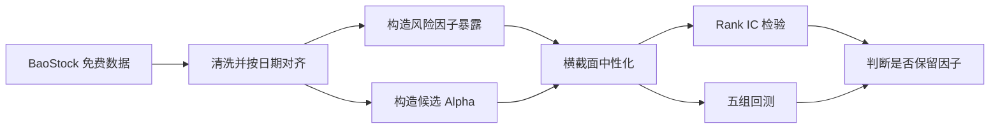
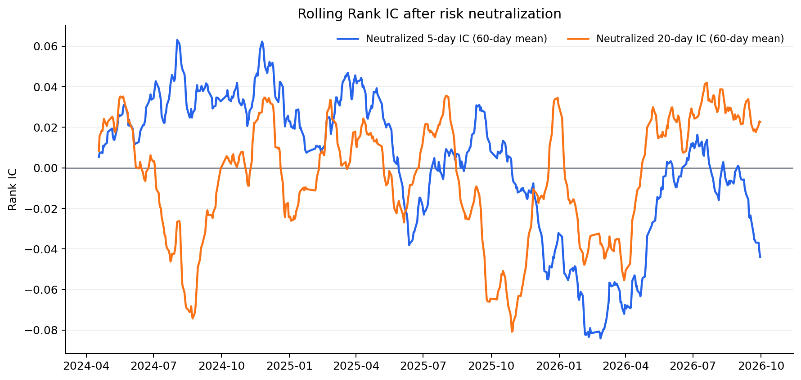
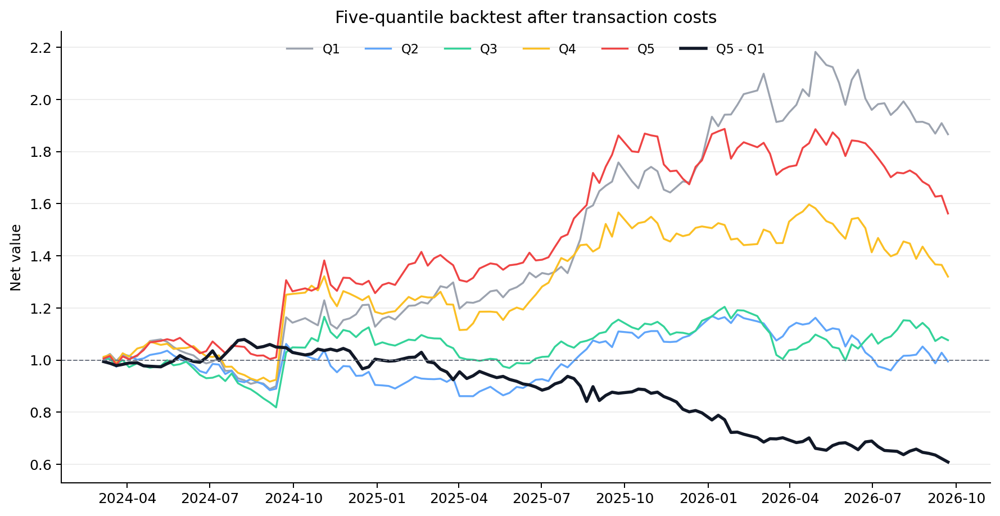

# 用免费数据走通一次 A 股因子研究：简化 Barra 风险控制与 Alpha 检验

> 本项目使用 BaoStock 免费接口，完成一条从数据获取、风险因子构造、行业与风格中性化，到 IC 和分组回测的最小研究链路。它是研究流程验证，不是 MSCI Barra 官方模型的复刻，也不构成投资建议。

## 一、我想解决什么问题

初学因子研究时，很容易把“算出一个指标”当成“挖到了 Alpha”。但股票收益可能只是来自市场上涨、行业轮动、小市值或高波动等共同风险。如果不先控制这些影响，我们无法判断候选信号是否提供了独立信息。

这次实验回答两个问题：

1. 能否只用免费接口，走通一条接近真实量化研究的完整流程？
2. 一个直觉上合理的“放量下跌反转”信号，在控制行业和 Barra 风格风险后是否仍然有效？

最终答案是：**流程已经跑通，但这个候选 Alpha 没有通过本次样本检验。** 失败结果同样有价值，因为它说明代码能够区分“程序运行成功”和“因子确实有效”。

## 二、研究流程



研究使用 2026 年 9 月 30 日沪深 300 成分股，在样本数最多的 10 个证监会行业中各固定抽取 6 只，共 60 只股票。行情区间为 2022 年 1 月 1 日至 2026 年 9 月 30 日；由于滚动窗口需要预热，实际因子检验从 2024 年 3 月开始。

## 三、风险因子是怎样构造的

本项目参考 CNE5 的公开思想，构造或近似构造以下风险暴露：

| 风险维度 | 本项目的实现 | 与正式 Barra 的主要差别 |
|---|---|---|
| Size | 总市值取自然对数 | 总股本来自最近已公布年报，年报之间可能不够及时 |
| Non-linear Size | 标准化 Size 的三次项，再对 Size 正交化 | 缺少官方清洗与加权口径 |
| Beta | 252 日加权回归，半衰期 63 日，市场用沪深 300 | 正式模型使用更完整的估计域和无风险收益 |
| Momentum | 504 日收益，跳过最近 21 日，半衰期 126 日 | 免费数据缺少官方调整过程 |
| Residual Volatility | DASTD、CMRA、HSIGMA 合成，再对 Beta 正交化 | 只复现公开公式的核心部分 |
| Liquidity | STOM、STOQ、STOA 合成 | 使用免费换手率字段 |
| Earnings Yield | 正 PE 的倒数 | 缺少分析师预测和现金盈利描述变量 |
| Book-to-Price | 正 PB 的倒数 | 是近似代理，不是完整时点账面权益计算 |
| 行业 | 10 个证监会行业的 0/1 暴露 | 正式 CNE5 使用历史 GICS 行业体系 |

### 行业因子为什么是 0 和 1

行业暴露不是一个连续打分。某股票属于医药制造业，则医药行业暴露为 1，其他行业暴露为 0。程序在每日横截面回归中加入这些行业变量，用于剔除候选 Alpha 中由行业归属带来的影响。

回归包含截距时，需要省略一个行业作为比较基准，避免完全共线。导出的 [`行业因子暴露.csv`](outputs/free_factor_pilot/行业因子暴露.csv) 仍保留全部 10 个行业列，方便查看。

这里完成的是**行业中性化控制**。由于没有 32 个 GICS 行业的完整历史归属，也没有估计每日行业因子收益、因子协方差和个股特异风险，所以不能称为完整 Barra 行业模型。

## 四、候选 Alpha：放量下跌反转

候选信号定义为：

```text
Alpha = -过去5日收益 × max[ln(5日平均换手率 / 60日平均换手率), 0]
```

背后的假设是：如果股票短期明显下跌，同时成交活跃度显著高于平时，价格可能包含集中卖出或情绪冲击，之后存在短期修复的可能。

对每个交易日，程序执行以下回归：

```text
候选 Alpha
= 截距
+ 行业暴露
+ Size、Non-linear Size、Beta、Momentum
+ Residual Volatility、Liquidity
+ 估值代理
+ 残差
```

回归残差就是中性化后的 Alpha。它代表候选信号中不能被已控制风险因子解释的部分。

## 五、如何判断 Alpha 是否有效

### 1. Rank IC

IC 衡量“今天的因子排序”和“未来收益排序”是否一致。这里使用 Spearman 秩相关：

- IC 大于 0：因子分数越高的股票，未来收益通常越高；
- IC 接近 0：排序关系不明显；
- IC 小于 0：关系可能与预期方向相反。

ICIR 在本项目中定义为每日 IC 均值除以每日 IC 标准差，用来观察信号相对波动是否稳定。它没有做年化处理。

### 2. 五组回测

每天按中性化后的因子分数排序，将股票分成 Q1 至 Q5 五组。每 5 个交易日调仓一次，组内等权，并假设单边交易成本为 0.15%。如果因子有效，通常希望五组表现大致单调，并且高分组相对低分组有稳定优势。

## 六、实验结果

| 指标 | 原始 5 日 | 原始 20 日 | 中性化 5 日 | 中性化 20 日 |
|---|---:|---:|---:|---:|
| 平均 Rank IC | 0.0062 | -0.0011 | -0.0007 | -0.0049 |
| ICIR | 0.0326 | -0.0064 | -0.0053 | -0.0353 |
| IC 为正比例 | 51.47% | 48.46% | 51.69% | 49.83% |



中性化后的平均 IC 几乎为 0，说明这个信号没有表现出稳定的横截面预测能力。

五组最终净值如下：

| 组合 | 最终净值 |
|---|---:|
| Q1 | 1.8664 |
| Q2 | 0.9944 |
| Q3 | 1.0765 |
| Q4 | 1.3203 |
| Q5 | 1.5625 |
| Q5 − Q1 研究多空组合 | 0.6088 |



五组表现不单调，而且 Q5 − Q1 组合最终净值低于 1。因此，本次实验不能把“放量下跌反转”认定为有效 Alpha。

## 七、这次实验做了哪些简化

这些限制会直接影响结论的外推范围：

1. 股票池使用期末成分股和期末行业分类，存在幸存者偏差和历史成分偏差。
2. 样本只有 60 只股票，无法代表全 A 股横截面。
3. 市场收益用沪深 300 代替完整估计域，无风险日收益暂设为 0。
4. PE、PB 倒数只是估值代理，缺少分析师预测、现金盈利和严格的时点财务数据。
5. 行业使用当前证监会分类，没有恢复每一天当时有效的历史分类。
6. 回测只采用固定费率，没有模拟涨跌停、停牌、成交容量和冲击成本。
7. 本项目只对候选 Alpha 做风险中性化，没有完成正式风险模型所需的因子收益、协方差矩阵和特异风险预测。

因此，正确结论是“免费数据能够验证研究流程，这个候选信号在当前设置下无效”，而不是对该信号在整个 A 股市场作永久判断。

## 八、怎样复现

建议使用 Python 3.10 或更新版本：

```bash
python -m venv .venv
source .venv/bin/activate
pip install -r requirements.txt
python work/run_free_factor_pilot.py
python scripts/make_charts.py
```

程序会通过 BaoStock 获取数据，并在 `outputs/free_factor_pilot/` 生成：

- `样本股票池.csv`：60 只样本股票及行业；
- `行业因子暴露.csv`：10 个行业的 0/1 暴露；
- `因子暴露与未来收益.csv`：逐日风险暴露、Alpha 和未来收益；
- `IC序列.csv` 与 `IC汇总.json`：IC 检验结果；
- `五组回测.csv`：五组组合和研究多空组合净值；
- `研究报告.md`：自动生成的实验摘要。

仓库只保留体积较小的汇总结果。行情缓存和逐日大文件会在本地运行时生成。

## 九、下一步

如果继续把它推进成更接近正式研究的版本，我会按以下顺序处理：

1. 建立历史动态股票池，加入退市股票，减少幸存者偏差；
2. 扩大到全 A 股，并加入上市天数、ST、停牌和流动性过滤；
3. 按真实公告日期构建 point-in-time 财务数据库；
4. 获取历史行业变更并估计行业与风格因子收益；
5. 加入因子协方差和个股特异风险，形成可用于组合优化的风险模型；
6. 对新的 Alpha 假设进行样本内、样本外和不同市场状态检验。

这次实验最重要的结果不是找到一个赚钱公式，而是建立了一条可以重复使用的研究管线：**先提出经济假设，再控制已知风险，最后用 IC、分组单调性和可交易性证据决定是否保留因子。**

## 主要参考资料

- MSCI, *Barra China Equity Model (CNE5)*.
- MSCI, *China Equity Factor Model*.
- BaoStock 免费证券数据平台及 Python API。

数据研究区间截至 2026 年 9 月 30 日。代码和结果仅用于学习与研究。
